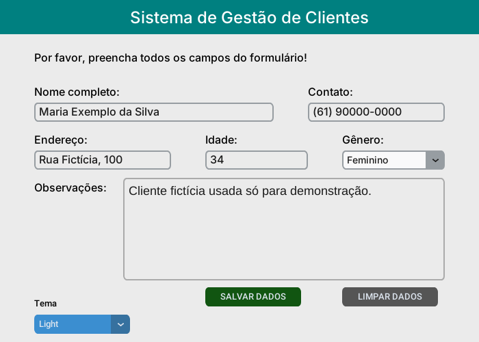
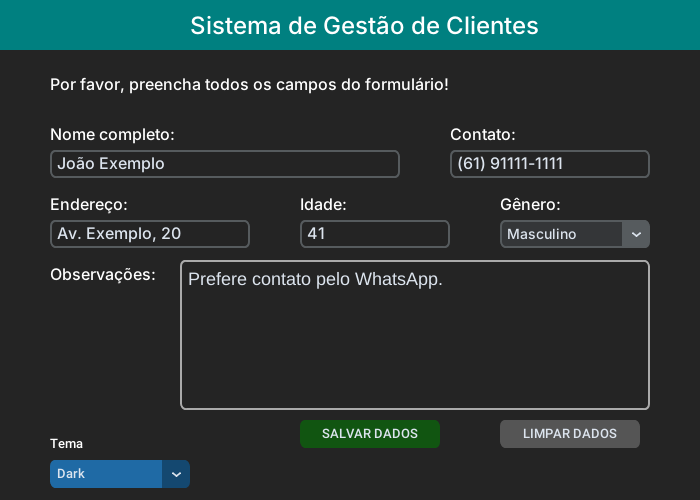
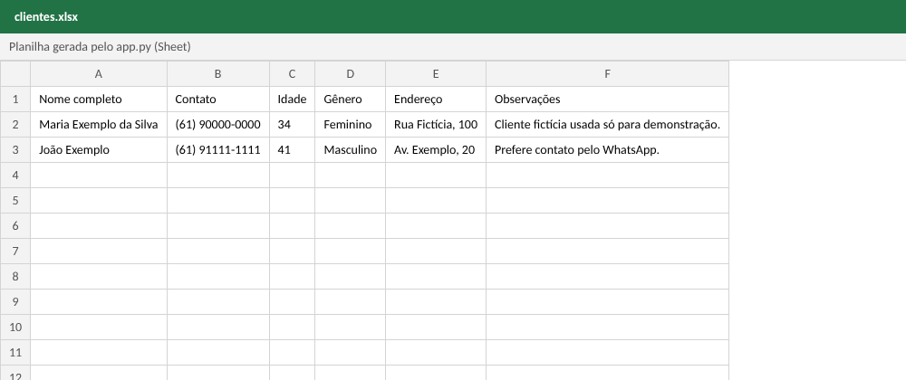

<p align="center">
  
</p>

<h1 align="center">🗂️ Sistema de Gestão de Clientes</h1>

<p align="center">
  Aplicativo desktop em Python para o <b>cadastro rápido de clientes</b>: um formulário com interface moderna
  (temas claro e escuro) que grava cada ficha em uma <b>planilha Excel</b>.
</p>

<p align="center">
  
  
  
</p>

<p align="center">
  <a href="#-sobre-o-projeto">Sobre</a> •
  <a href="#-funcionalidades">Funcionalidades</a> •
  <a href="#️-telas">Telas</a> •
  <a href="#-como-executar">Como executar</a> •
  <a href="#-estrutura-do-projeto">Estrutura</a> •
  <a href="#️-tecnologias">Tecnologias</a>
</p>

---

## 📌 Sobre o projeto

Um sistema simples para quem precisa registrar clientes sem montar um banco de dados: o próprio arquivo
`clientes.xlsx` funciona como base. Na primeira execução o programa cria a planilha com o cabeçalho; a cada
cadastro salvo, uma nova linha é adicionada. Depois é só abrir o arquivo no Excel, LibreOffice ou Google Planilhas.

## ✨ Funcionalidades

| | Recurso | Descrição |
|---|---|---|
| 📝 | **Formulário de cadastro** | Nome completo, contato, idade, endereço, gênero e observações |
| ⚠️ | **Validação** | Se nome, contato, idade ou endereço estiverem vazios, mostra um aviso e não salva |
| 📊 | **Planilha Excel** | Cada cadastro vira uma linha em `clientes.xlsx`, criado automaticamente com o cabeçalho |
| 🧹 | **Limpar dados** | Esvazia os campos para o próximo cadastro |
| 🌗 | **Temas** | Light, Dark ou System (segue o tema do sistema operacional) |

## 🖼️ Telas

<table>
  <tr>
    <td align="center"><b>Tema claro</b><br></td>
    <td align="center"><b>Tema escuro</b><br></td>
  </tr>
  <tr>
    <td align="center" colspan="2"><b>Planilha gerada</b> (conteúdo do <code>clientes.xlsx</code> após dois cadastros de teste, com dados fictícios)<br></td>
  </tr>
</table>

## 🚀 Como executar

**Pré-requisito:** Python 3 com Tkinter (no Linux, pacote `python3-tk`).

```bash
git clone https://github.com/kauaxp77/Sistema_Gestao_Clientes_Python.git
cd Sistema_Gestao_Clientes_Python
pip install -r requirements.txt
python app.py
```

O arquivo `clientes.xlsx` é criado na pasta de onde o programa é executado.

> 🔒 A planilha guarda dados pessoais dos clientes e por isso está no `.gitignore`: ela fica só no computador
> de quem usa o sistema e não deve ser enviada ao repositório.

## 📁 Estrutura do projeto

```
Sistema_Gestao_Clientes_Python/
├── app.py             # Interface (CustomTkinter) e gravação na planilha (openpyxl)
├── requirements.txt   # customtkinter e openpyxl
└── docs/
    ├── banner.png
    └── screenshots/   # Capturas de tela usadas neste README
```

## 🛠️ Tecnologias

- **Python 3**: linguagem principal
- **CustomTkinter**: interface gráfica moderna, com temas claro e escuro
- **openpyxl**: criação e escrita da planilha `.xlsx`
- **Tkinter (messagebox)**: mensagens de erro e de sucesso

## 👨‍💻 Autor

Desenvolvido por **[kauaxp77](https://github.com/kauaxp77)**

<p align="center">⭐ Se curtiu o projeto, deixe uma estrela!</p>
